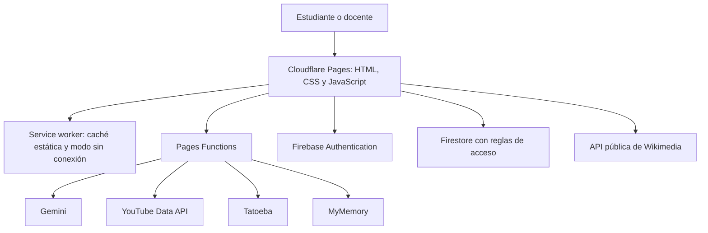

# Arquitectura

## Recorrido de una solicitud

## Sitio estático

`wrangler.jsonc` publica el directorio `outputs/`. Allí viven el portal, las páginas institucionales, los juegos, los recursos, los estilos, los scripts y el service worker. No se ejecuta una compilación para crear el sitio.

Villa Esther está organizada dentro de `outputs/instituciones/villa-esther/`. Sus archivos propios también se agrupan en `outputs/css/villa-esther/`, `outputs/js/villa-esther/` y `outputs/assets/villa-esther/`. Vicente Díaz tiene su página en `outputs/instituciones/` y sus recursos de marca en carpetas `vicente-diaz` bajo `css/` y `assets/`.

## API y funciones de servidor

Cloudflare Pages detecta los endpoints de `functions/api/`:

- `aula.js` expone `POST /api/aula`, valida entradas y la sesión Firebase, aplica límites de uso y llama a Gemini.
- `youtube.js` expone `GET /api/youtube` y busca videos de los temas educativos permitidos.
- `phrases.js` expone `GET /api/phrases` y consulta frases de Tatoeba.
- `translate.js` expone `GET /api/translate` y consulta MyMemory para traducir entre español e inglés.

Las claves `GEMINI_API_KEY` y `YOUTUBE_API_KEY` se guardan como secretos de Cloudflare. No deben aparecer en archivos que descarga el navegador.

## Firebase

El cliente usa Firebase Authentication y Firestore para las cuentas, las clases y el progreso del aula de Villa Esther. `firestore.rules` controla cada lectura y escritura. `firebase-functions/` contiene funciones de servidor; `set-teacher-role.js` es una herramienta administrativa que asigna claims docentes.

La configuración Firebase del navegador está en `outputs/js/villa-esther/firebase-config.js`. Identifica la app web y no reemplaza las reglas de Firestore ni debe contener secretos de proveedor.

## Modo sin conexión y aplicaciones instalables

`outputs/service-worker.js` almacena páginas y recursos estáticos listados en `CORE`. Los manifiestos `manifest.webmanifest`, `manifest-villa-esther.webmanifest` y `manifest-vicente-diaz.webmanifest` identifican las instalaciones independientes de la plataforma general y de cada institución.

El contenido local precargado puede abrirse sin conexión después de visitar el sitio con internet. Gemini, YouTube, traducciones externas, autenticación y sincronización requieren internet. El servidor estático local no ejecuta Pages Functions.

## Decisiones de diseño

- Mantener el sitio estático para facilitar su inspección y publicación.
- Separar los recursos institucionales para conservar su identidad y facilitar cambios por colegio.
- Usar Pages Functions para servicios externos que requieren claves o validación de servidor.
- Tratar las respuestas de IA y traducción automática como material de apoyo sujeto a revisión.
